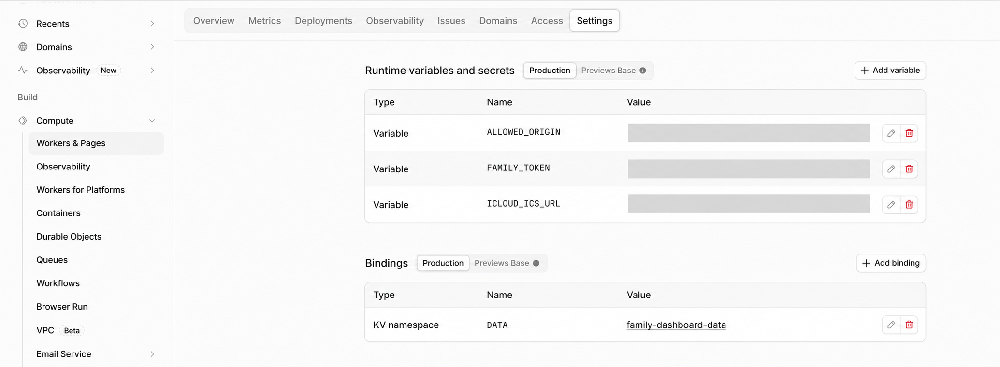
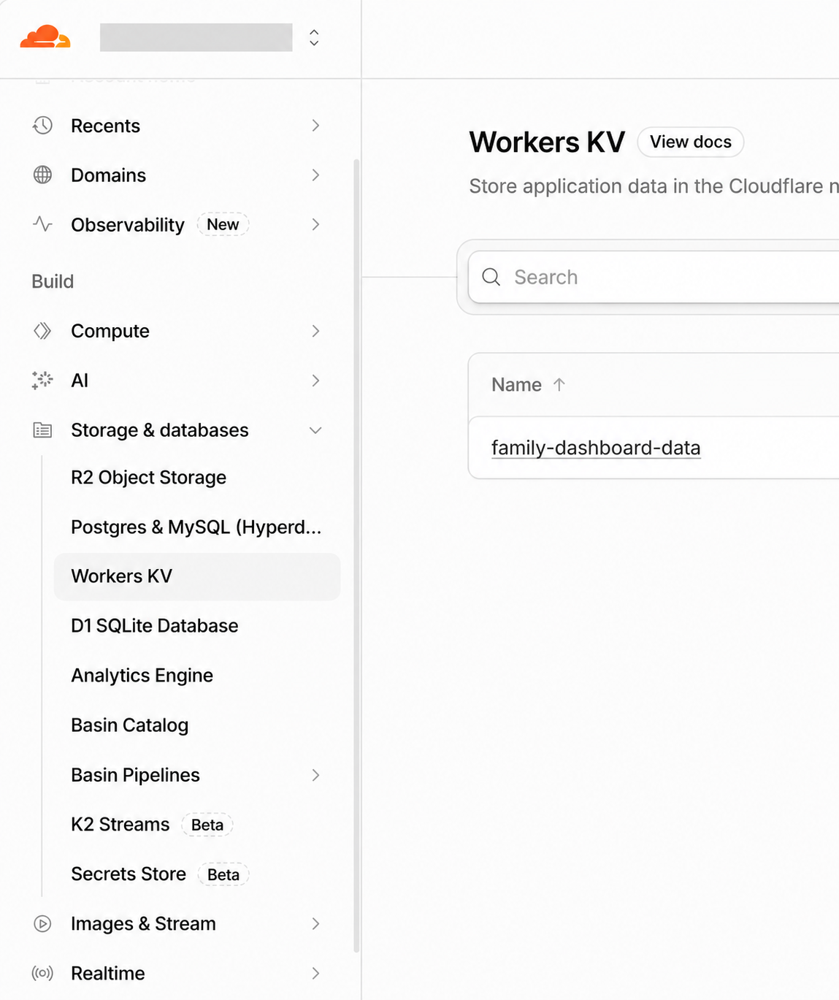

# Family Dashboard

Shared calendars, a to-do list, and a shopping list for phones and a wall display.
The Angular frontend runs on GitHub Pages; a Cloudflare Worker accesses the
calendar and stores shared lists in Cloudflare KV.

## Configuration

| Location | What to maintain |
|---|---|
| [`src/app/settings.ts`](src/app/settings.ts) | Worker URL, language and text, calendar range, refresh intervals, theme colour, and frame settings. An empty `workerUrl` enables demo mode. |
| [`src/styles.css`](src/styles.css) | Colours, fonts, and responsive styles. Keep the initial theme colours aligned with `settings.ts`. |
| [`src/app/app.html`](src/app/app.html) | Main screen layout. Calendar, list, and shell components are under `src/app/`. |
| [`public/`](public/) and [`src/index.html`](src/index.html) | App icons, manifest, and page title. |
| [`worker/worker.js`](worker/worker.js) | Backend authentication, calendar fetching, and list updates. |
| [`worker/wrangler.toml`](worker/wrangler.toml) | Optional CLI deployment settings and KV binding. Replace placeholders before use; keep secrets out of this file. |
| [`package.json`](package.json) and `package-lock.json` | Supported Node.js versions, commands, and pinned dependencies. |

Cloudflare dashboard: <https://dash.cloudflare.com/>. Select your account, then
open **Compute →** [**Workers & Pages**](https://dash.cloudflare.com/?to=/:account/workers-and-pages),
select **family-dashboard**. Menu paths below start from that Worker.

| Setting | Where to find or edit it | Purpose |
|---|---|---|
| `DATA` (KV binding) | **Settings → Bindings → DATA → pencil icon**; **Add binding → KV namespace** if missing. | Connects the Worker to the namespace holding shared data. |
| `FAMILY_TOKEN` (secret) | **Settings → Runtime variables and secrets → FAMILY_TOKEN → pencil icon**; **Add variable** if missing, with type **Secret**. | Shared password required to read the calendar and read or change lists. Existing secret values are hidden; replace them to change them. |
| `ICLOUD_ICS_URL` (secret) | **Settings → Runtime variables and secrets → ICLOUD_ICS_URL → pencil icon**; **Add variable** if missing, with type **Secret**. | Public iCloud calendar subscription link. |
| `ICLOUD_ICS_URL_2` (secret; optional) | **Settings → Runtime variables and secrets → Add variable**, type **Secret**. | Second calendar subscription link. Add `_3`, `_4`, etc. for more calendars. |
| `ALLOWED_ORIGIN` (variable) | **Settings → Runtime variables and secrets → ALLOWED_ORIGIN → pencil icon**; **Add variable** if missing, with type **Text**. | Frontend origin, such as `https://<username>.github.io`, without the repository path or trailing slash. This is a browser restriction, not authentication. |



The screenshot shows the navigation; store `FAMILY_TOKEN` and all `ICLOUD_ICS_URL` links as
**Secret**, rather than the plain **Variable** type shown. Some dashboard versions
label the section **Variables and Secrets** or provide a separate **Bindings** tab.

Find the Worker address under **Settings → Domains & Routes**; use it as
`workerUrl` in `src/app/settings.ts`. Save or deploy changes when prompted.

## Multiple shared calendars

The agenda combines all configured calendars in chronological order. Events keep
an event-specific colour when supplied, otherwise the calendar colour from its
feed is used for the shadow. Feeds without colours use the dashboard theme colour.
Each feed is parsed separately, so matching event IDs across calendars do not
replace each other. Events appearing in both calendars are displayed twice.

For an existing installation:

1. Deploy the updated [`worker/worker.js`](worker/worker.js) first using **Edit code → Deploy**.
   The old `/calendar` endpoint still serves the first calendar for older app versions.
2. Keep the existing `ICLOUD_ICS_URL` secret. Add a **Secret** named
   `ICLOUD_ICS_URL_2` with the second calendar's public subscription link, then save/deploy.
   There is no new API key or family token to create. Never paste real links into Git or chat.
3. Deploy the updated frontend through the existing GitHub Pages workflow and reload
   the dashboard. No frontend setting needs to change when adding more calendars.

The frontend uses the authenticated `/calendars` endpoint. Each feed has its own
15-minute Worker cache and all feeds are saved together on each device for offline
use. If a feed fails, the Worker serves its last cached copy when available; the
other feeds remain visible. The calendar error label indicates missing or stale
feeds. A total refresh failure keeps the previous local agenda. Cache keys contain
hashes, not subscription links, and a replacement link never reuses an old feed's cache.

## Clock and weather

The clock shows Madrid time with seconds, the weekday, and the full date.
Weather is configured for **Loriguilla, CP 46393** (39.49, -0.57) in
`settings.ts`: coordinates, display name, time zone, and refresh interval.
The card shows the current temperature in Celsius and the next three hourly
forecasts, refreshed every 15 minutes. Failed refreshes keep the last successful
reading for the current session with a stale-data notice; an initial failure shows
“Weather unavailable” and retries after one minute. When the provider returns an
overload or rate-limit response, the card shows “Weather provider is busy”. Failed
requests retry every minute; successful requests restore the 15-minute interval.

Weather requests go directly to [Open-Meteo](https://open-meteo.com/en/docs),
without the family token. Its API needs no key and is
[free for personal, non-commercial use](https://open-meteo.com/en/terms).
The card includes provider attribution. AEMET also provides
[free OpenData](https://opendata.aemet.es/centrodedescargas/info), but requires
registration for an API key.

## Storage and backups

| Location | Contents |
|---|---|
| iCloud Calendar | Original calendar events; edit them in Apple Calendar. |
| [Cloudflare KV](https://dash.cloudflare.com/?to=/:account/workers/kv/namespaces), bound as `DATA` | `list:todo` and `list:groceries` hold shared lists. `cache:calendar:<hash>` holds each fetched calendar separately, refreshed after 15 minutes when requested and expired after 30 days without a successful fetch. Old `cache:calendar` entries are no longer used. |
| Each browser’s `localStorage` | `fd:token` stores the password; `fd:list:todo`, `fd:list:groceries`, and `fd:calendars` store local copies. The old `fd:ics` copy remains usable during the first offline upgrade. Demo data uses `fd:demo:…`. |

To view or edit stored data, open **Storage & databases → Workers KV →
family-dashboard-data → KV Pairs** (or the namespace bound as `DATA` if renamed).
Select a key to inspect or edit its value; use its delete action to remove it.
Check **Worker → Settings → Bindings → DATA** for the namespace
name if unsure.



Back up lists by securely exporting or copying their KV values before changing or
deleting data. The app has no list history or automatic backups. Browser copies
are for offline display, not a dependable backup. Clearing site data removes the
saved password and local copies; it does not delete shared KV data. KV propagation
and app polling can delay updates between devices.

## Run and deploy

Use a Node.js version supported by `package.json`.

```bash
npm ci
npm start       # Development server at http://localhost:4200
npm test        # Unit tests
npm run build   # Production output: dist/family-dashboard/browser
```

For local demo use, temporarily set `workerUrl` to an empty string. Open
`?mode=frame` for the wall display. On a connected device, enter the family token
in the app when prompted; the browser remembers it. Configure a kiosk browser to
open the frontend URL with `?mode=frame` for a permanent display.

- **Frontend:** GitHub repository → **Settings → Pages**, with **GitHub Actions**
  as the source. Inspect [`.github/workflows/pages.yml`](.github/workflows/pages.yml)
  and its latest run under **Actions** when checking deployment. A push to `main`
  installs dependencies, runs tests, builds Angular with the Pages base path, and
  publishes `dist/family-dashboard/browser`.
- **Worker:** update `worker/worker.js`, then open
  [**Workers & Pages**](https://dash.cloudflare.com/?to=/:account/workers-and-pages)
  → **family-dashboard → Edit code**, paste the code, and select **Deploy**.
  Review releases under **family-dashboard → Deployments**.
  Frontend pushes do not deploy the Worker. CLI deployment is
  also possible after configuring `worker/wrangler.toml`.

See [`docs/setup-guide-en.md`](docs/setup-guide-en.md) for initial setup.

## Routine maintenance

| Task or symptom | Action |
|---|---|
| Rotate the shared password | Replace `FAMILY_TOKEN` in Cloudflare, then enter the new token on each device when prompted. Keep a copy in a password manager. |
| Add, replace, or remove a calendar | Edit the `ICLOUD_ICS_URL`, `ICLOUD_ICS_URL_2`, etc. secrets in Cloudflare, then reload the dashboard. A changed link gets a new cache automatically; removed secrets disappear on the next successful refresh. Existing browser copies remain available offline. |
| Token repeatedly rejected | Check the entered value against the configured `FAMILY_TOKEN`; replace the secret if needed. |
| Offline or stale data | Check `workerUrl`, Worker availability, `DATA`, and `ALLOWED_ORIGIN`. For calendar problems, check that the iCloud public link still works. |
| Demo data on the published site | Set `workerUrl`, rebuild, and deploy the frontend. |
| Failed deployment or blank page | Read the GitHub Actions logs and browser console; check the Angular build output and Pages base path. |
| Update dependencies | Update the package files together, run tests and a production build, and check the app locally before deploying. |
| Wall display shows an old version | Reload the kiosk browser; keep its browser/WebView updated. |

## Keep private

Never commit real tokens, calendar subscription links, personal calendar/list
contents, or data exports. Configuration names and storage keys are maintenance
references, not credentials. The Worker URL is public frontend configuration;
avoid adding account-specific addresses to documentation unnecessarily.

Anyone with the family token can read the calendar and change lists. Anyone with
the public iCloud subscription link can read that calendar directly, independently
of the Worker token. Treat both values as secrets. Browser storage also contains
the token and cached personal data, so use trusted devices and clear site data
when retiring one. Rotating the token does not erase previously cached data.
